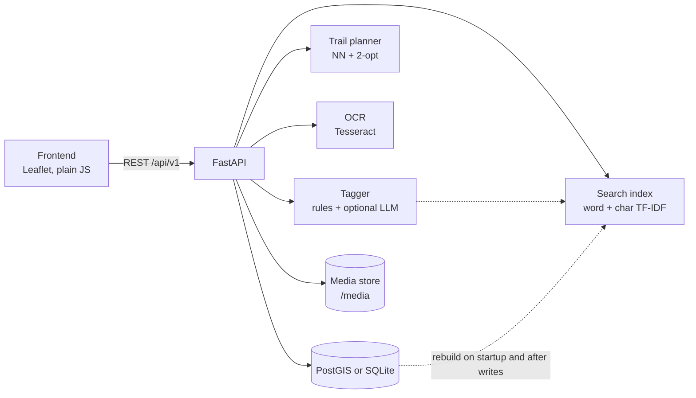
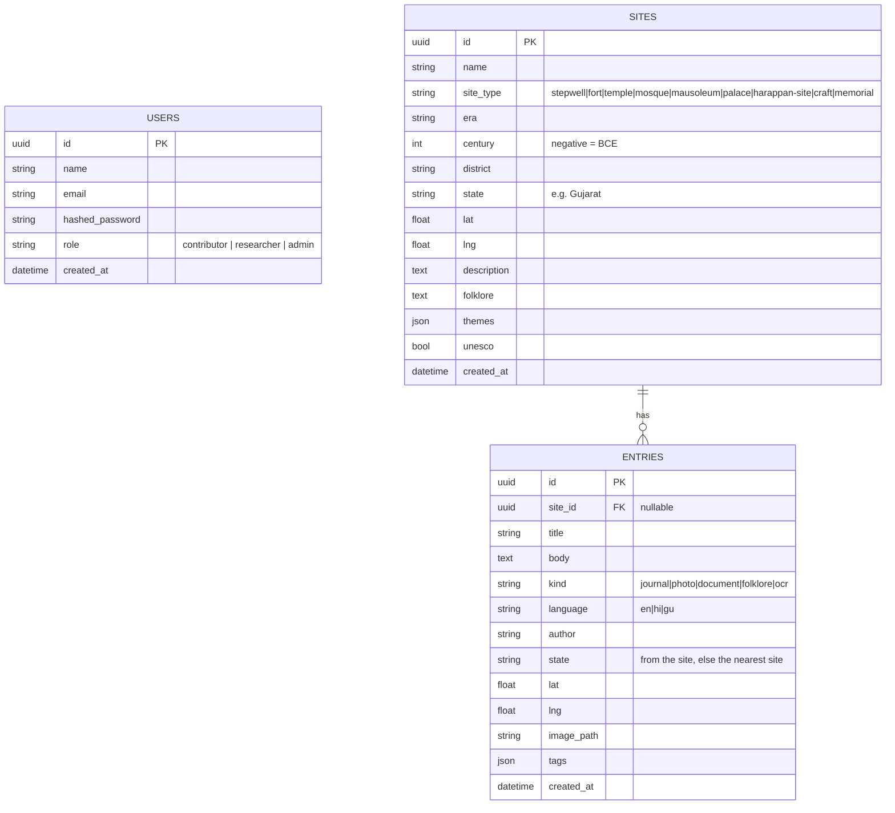

# Virasat Atlas

**Turning unstructured heritage field notes into a searchable, mappable archive of Gujarat.**

Submission for HC26-CULT01, *Digital Revitalisation of Unstructured Cultural & Architectural Heritage Archives* (IIT Gandhinagar, Blithchron).
Pathways: **Geospatial / Immersive Web** (primary) and **Archival NLP / OCR** (secondary).

> **Demo data notice.** The 24 sites and 12 field entries that ship with the seed script are **sample content for demonstration**. Coordinates were cross-checked against public references, but descriptions are short summaries, not scholarly records, and the field entries are invented notes by fictional "Demo Fellow" authors.

## The problem

Field documentation of heritage (travel journals, photographs, scanned Hindi and Gujarati documents, folklore notes) piles up as unstructured files. Nobody can search it, nobody can see it on a map, and the Hindi and Gujarati material is invisible to English keyword search. Knowledge gathered on one fellowship trip is effectively lost to the next.

## The solution

Virasat Atlas ingests a note, a photo or a scanned page, **tags it automatically** (site type, era, century, themes, language), **attaches it to the nearest known site**, and makes everything **searchable across English, Hindi and Gujarati** on an interactive map. It can also plan a **heritage trail** through a cluster of sites.

## Features

- Interactive Leaflet map of Gujarat, colour-coded by site type, UNESCO sites ringed in gold, detail drawer with folklore and field entries
- Field entries at no known site appear as hollow dots on the map; the entry form has a State field (with suggestions), so you can record a state that has no sites yet and it joins the region list
- Region selector: "All India" plus every state that has sites, each with its site count. It scopes the map, site list, search, timeline and stats, defaults to Gujarat, and is kept in the URL (`#state=gujarat`, `#state=all`)
- Site photos: the backend looks up a representative photo for each site on Wikipedia / Wikimedia Commons (cached 10 minutes, credited in the drawer, silently skipped if unavailable)
- Multilingual auto-tagger (English, Devanagari, Gujarati) with century and BCE extraction and script detection; optional LLM layer when an API key is set
- Hybrid search: word TF-IDF (0.6) + character n-gram TF-IDF (0.4), so Hindi, Gujarati, transliteration and typos all work; optional dense layer via `SEMANTIC_MODEL`
- Field entry ingest with photo upload (verified as a real image), auto-attach to the nearest site within 2 km, and a live tag preview in the UI
- Heritage trails: cluster selection, nearest-neighbour ordering, 2-opt improvement, distance and time estimate
- OCR digitisation of scanned Hindi / Gujarati / English pages, with a "save as entry" flow
- Era timeline slider, type / era / theme filters, responsive layout with a mobile bottom sheet
- JWT authentication (bcrypt), clean JSON error envelope, 8 MB upload limit, Swagger docs at `/docs`

## Architecture



## Data model



On PostgreSQL a generated `geog` geography column and a GIST index are added to `sites` and `entries`. On SQLite, `lat`/`lng` are used with Haversine in Python.

## API (`/api/v1`)

| Method | Path | Purpose | Auth |
|---|---|---|---|
| GET | `/health` | Liveness | no |
| GET | `/meta` | Types, eras, themes, languages and `states` (with slug and site count); optional `state` scopes the counts | no |
| GET | `/sites` | List; filters `type`, `era`, `theme`, `unesco`, `state` | no |
| GET | `/sites/nearby` | `lat`, `lng`, `radius_km` | no |
| GET | `/sites/{id}` | Site with its entries | no |
| GET | `/sites/{id}/image` | Representative photo (Wikipedia / Commons), nulls if none | no |
| POST | `/sites` | Create a site | JWT |
| POST | `/entries` | Multipart: title, body, kind, author, optional site_id, lat/lng, state, image | no |
| GET | `/entries` | Entries, newest first; `state`, `unattached=true` (located entries with no site) | no |
| GET | `/entries/{id}` | One entry | no |
| POST | `/tag` | `{text}` to site type, era, century, themes, language | no |
| GET | `/search` | `q`, `k`, optional `state`: hybrid search over sites and entries | no |
| POST | `/trails` | `site_ids` or `theme`, optional start, `max_stops` 2-15 | no |
| POST | `/ocr` | Image upload (`file`, optional `lang`, default `hin+eng`) | no |
| POST | `/auth/register`, `/auth/login` | Accounts and tokens | no |
| GET | `/user/me` | Current user | JWT |

Errors use one envelope: `{"error": {"code": "...", "message": "...", "detail": ...}}`. Interactive docs: `http://localhost:8000/docs`.

`POST /entries` is open so a field contributor can submit without an account; `POST /sites` needs a token.

## Setup

### Option 1: Docker (PostGIS)

```bash
docker compose up --build
```

Open http://localhost:8000. The first start seeds the demo data.

> Docker has **not been run on the author's machine** (not installed there). The compose file is exercised by a CI job on push; check the Actions tab for its status.

### Option 2: local virtualenv (SQLite, no database needed)

```bash
python -m venv .venv
# Windows: .venv\Scripts\activate     macOS/Linux: source .venv/bin/activate
pip install -r requirements.txt
cp .env.example .env            # optional; defaults work
python scripts/seed.py          # loads demo data (skips if data exists; --reset to wipe)
uvicorn app.main:app --port 8000
```

Open http://localhost:8000. The seed prints a random password for the demo accounts once, or uses `SEED_PASSWORD` if you set it.

### Optional features

| Feature | How |
|---|---|
| OCR | Install Tesseract with the `hin`, `guj` and `eng` language packs. If it is not on `PATH`, set `TESSERACT_CMD`; for language data in a custom folder set `TESSDATA_PREFIX`. Without it `/ocr` returns **501** with a clear message. A sample scan is in `samples/hindi_sample.png`; on Windows with Tesseract 5.4 and the `hin` data it reads back as correct Hindi and is tagged as a Chaulukya stepwell. Language data can be fetched from `tesseract-ocr/tessdata_fast` into a `tessdata/` folder (git-ignored). |
| LLM tagging layer | Set `GEMINI_API_KEY` (a Google AI Studio key; `GEMINI_MODEL` defaults to `gemini-3.1-flash-lite`). It calls the Gemini REST API from the backend only, fills fields the rules left empty, is cached for 10 minutes, and never blocks ingest. |
| Dense search | `pip install -r requirements-semantic.txt` and set `SEMANTIC_MODEL=paraphrase-multilingual-MiniLM-L12-v2`. |

## Tests

```bash
pip install -r requirements-dev.txt
pytest
```

Tests use a temporary SQLite database and cover the tagger (stepwell, Hindi, century, BCE, and "port" not matching "important"), search (Hindi query finds a Hindi entry, "stepwell" finds Rani ki Vav), trails (ordering, distances, start anchoring), the API (listing, auto-attach, upload validation, auth, the OCR 501 path) and the seed data.

## Demo script (5 steps)

1. **Map and filters.** Open the app. 24 sites appear, colour-coded. Filter to *stepwell*, then drag the century slider to see the era narrow.
2. **Open a site.** Click *Rani ki Vav*: UNESCO badge, description, folklore and its field entries.
3. **Multilingual search.** Search `रानी की वाव`. The Hindi field note is found, with a Hindi chip. Then try `stepwel` (typo) and `જાળી` (the Gujarati note about a mosque lattice window).
4. **Add a field entry.** Click *Add Field Entry*, drop a pin near Patan, type a note and watch the tags appear live. Upload a photo and submit; it attaches to the nearest site.
5. **Trail and OCR.** Build a *water-architecture* trail and read the km and hours. Then *Digitise Document* with `samples/hindi_sample.png`, review the text and tags, and save it as an entry.

## Scalability notes

- **Spatial queries:** PostGIS `geography` columns with a GIST index (already created on PostgreSQL) keep nearby queries fast at millions of rows.
- **Vectors:** pgvector for embeddings, replacing the in-memory dense layer. Not enabled here because the stock `postgis/postgis` image does not include it.
- **Media:** move `/media` to object storage (S3 or GCS) behind a CDN.
- **Ingestion:** put tagging, OCR and indexing on a background queue so uploads return immediately.
- **Search:** the index is in memory and rebuilt after each write; shard by region or switch to a search service for large archives.

## Honest limitations

- Trail distances are **straight-line**, not road distance, and travel time is a rough estimate (45 km/h plus 1 hour per stop).
- Search is TF-IDF, which matches words and character patterns but does not understand meaning; the dense layer is optional and was not tested on the author's machine.
- The rule-based tagger covers a fixed vocabulary of Gujarat heritage terms and will miss anything outside it.
- The LLM tagging layer is covered by mocked tests only; it has not been run against the live API.
- OCR quality depends on the scan. Printed Hindi works far better than handwriting or old manuscripts.
- The PostGIS nearby query and the Docker setup are untested locally.
- Site photos come live from Wikipedia / Wikimedia Commons, so they need internet access and are matched by site name; licences are on each photo's source page. Always check a match before relying on it.
- The demo data covers Gujarat only, so the region selector offers just "All India" and "Gujarat" until sites in other states are added. A state's map view is fitted to its sites' coordinates, not its official boundary.
- Trails are not scoped by region: a theme trail can draw on sites from any state.
- A new site or entry without a `state` takes the state of the nearest existing site, which can be wrong near a state border; pass `state` explicitly to override it.
- Seed content is demo data (see the notice at the top).

## Roadmap

- 3D digital twins from photogrammetry, viewed with WebGL / Three.js
- IndicTrans translation so every entry is readable in all three languages
- Crowdsourced verification and a researcher review queue
- Mapbox 3D terrain and historic map overlays

## Credits and license

Built on a FastAPI + async SQLAlchemy backend originally written for a different project (SafeRoute); the auth layer, project layout and logging come from it. Released under the MIT License (see `LICENSE`).
